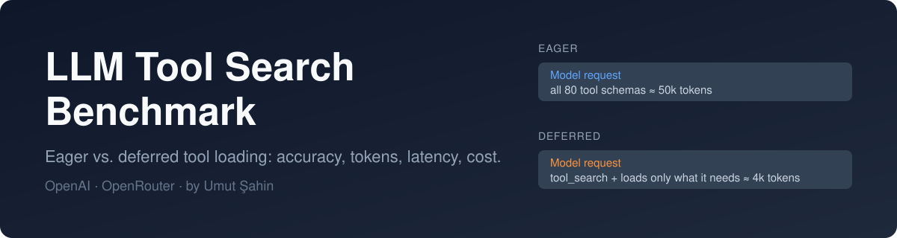
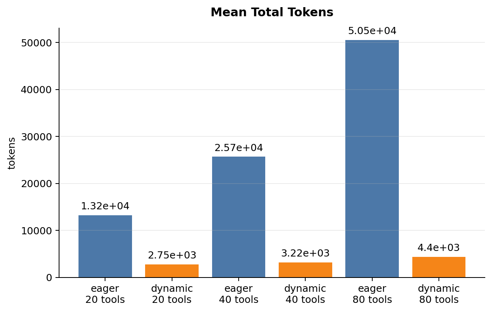
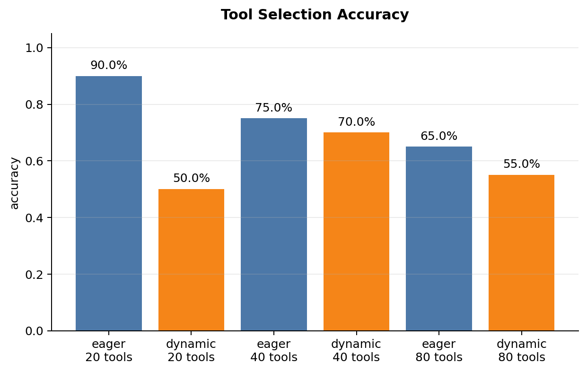
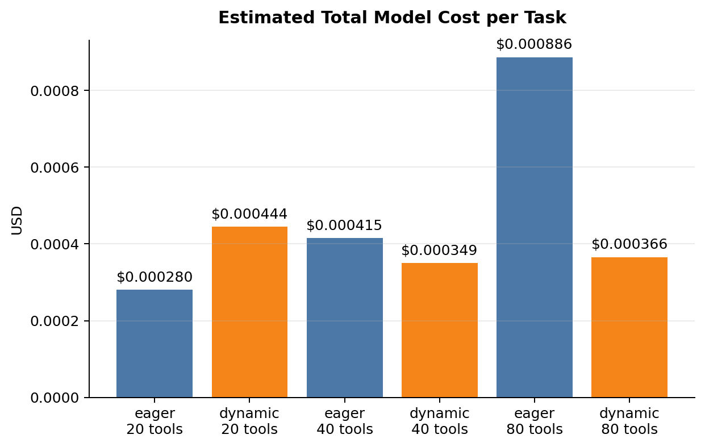
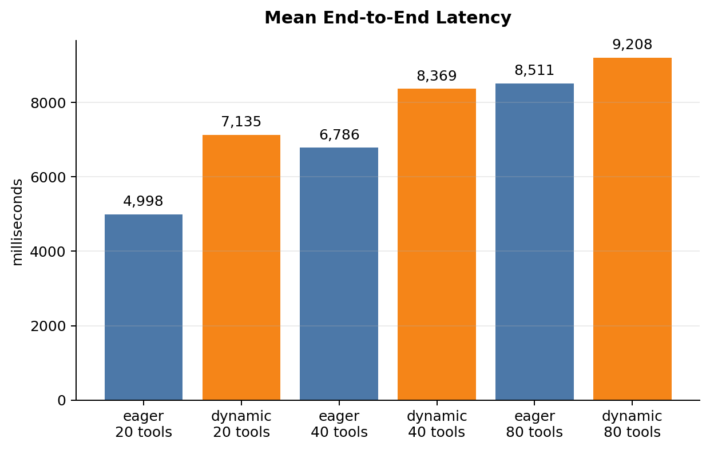

<div align="center">



<p>
  <a href="https://github.com/UmutSahin0/llm-tool-search-benchmark/actions/workflows/ci.yml"></a>
  <a href="LICENSE"></a>
  
</p>

<p>
  <a href="https://www.linkedin.com/in/umutsahinn1/"></a>
  <a href="https://medium.com/@umutsahinn1"></a>
  <a href="https://github.com/UmutSahin0"></a>
</p>

</div>

# LLM Tool Search Benchmark

**Does deferred tool loading save tokens without hurting tool-selection accuracy?**

When an LLM agent has dozens of tools, sending every tool schema with every request is expensive. Some providers now offer *tool search*: the model gets a search tool and loads only the schemas it needs (`defer_loading`). This repository measures what that trade-off actually looks like, on your model, with your prices.

It runs the same tasks against the same tool catalog in two modes and compares them:

| Mode | What the model receives |
| --- | --- |
| **Eager** | Every business-tool schema, callable from the start. |
| **Deferred** (`dynamic` in charts and CSVs) | The same tools marked `defer_loading`, discovered through hosted tool search. |

The two modes differ **only** in `defer_loading`, so any difference in the results is caused by tool loading and nothing else.

## What you get

For every catalog size and mode, the benchmark records:

- **Tool-selection accuracy**: did the model call the expected tool?
- **Tokens**: input, cached, output, reasoning, total
- **Latency**: mean and p95
- **Cost**: estimated from the per-million-token prices you configure, including cache savings and cost per correct selection
- **Callable tools** the model could see when it decided

Each run is saved to `experiments/NNN/` as CSVs, run metadata, a task snapshot, and PNG charts.

## Quick start

Requires Python 3.10+ and an OpenAI or OpenRouter API key.

```bash
git clone https://github.com/UmutSahin0/llm-tool-search-benchmark.git
cd llm-tool-search-benchmark
python -m venv .venv
source .venv/bin/activate        # Windows: .\.venv\Scripts\Activate.ps1
pip install -r requirements.txt
cp .env.example .env             # Windows: Copy-Item .env.example .env
```

Open `.env`, add one provider key, and set the current per-million-token prices for your model (they are saved with every run so results stay reproducible).

Run a small smoke test (3 tasks, one catalog size, roughly cents of API spend), then build the charts:

```bash
python -m benchmark.run --provider openai --catalog-sizes 20 --max-tasks 3 --repetitions 1
python analyze_results.py
```

Run a full, comparable benchmark:

```bash
python -m benchmark.run --provider openai --catalog-sizes 20,40,80 --schema-profile rich --max-tasks 20 --repetitions 3
python analyze_results.py
```

Compare two or more finished experiments:

```bash
python compare_experiments.py --experiments 031 033
```

### Options

| Flag | Default | Meaning |
| --- | --- | --- |
| `--provider` | `openrouter` | `openai` (Responses `tool_search`) or `openrouter` (`openrouter:tool_search`) |
| `--model` | from `.env` | Provider model ID |
| `--catalog-sizes` | `20,40,80` | Comma-separated number of tools in the catalog |
| `--schema-profile` | `rich` | `compact` or `rich` tool descriptions |
| `--max-tasks` | `20` | How many routing tasks to run |
| `--repetitions` | `1` | Repeat each task for more stable numbers |

For OpenAI the key and default model come from `OPENAI_API_KEY` / `OPENAI_MODEL`; for OpenRouter from `OPENROUTER_API_KEY` / `OPENROUTER_MODEL`. [`.env.example`](.env.example) documents every setting.

To compare results fairly, keep the model, task count, schema profile, catalog sizes, repetitions, and prices identical between runs.

## Example results

From one run: OpenAI `gpt-6-luna`, rich schemas, 20 tasks, **one repetition**. This is an illustration, not a general performance claim; use at least three repetitions before drawing conclusions.

| Catalog | Mode | Accuracy | Mean total tokens | Mean cost | Mean latency |
| ---: | --- | ---: | ---: | ---: | ---: |
| 20 tools | Eager | 90% | 13,215 | $0.000280 | 5.00 s |
| 20 tools | Deferred | 50% | 2,754 | $0.000444 | 7.14 s |
| 40 tools | Eager | 75% | 25,681 | $0.000415 | 6.79 s |
| 40 tools | Deferred | 70% | 3,220 | $0.000349 | 8.37 s |
| 80 tools | Eager | 65% | 50,533 | $0.000886 | 8.51 s |
| 80 tools | Deferred | 55% | 4,397 | $0.000366 | 9.21 s |

Deferred loading cut token use by 79-91% in this run, but accuracy was lower and latency higher. Eager prompts were almost fully cached, so the token savings became a cost advantage only from 40 tools upward; at 20 tools eager was cheaper.

<table>
  <tr>
    <td></td>
    <td></td>
  </tr>
  <tr>
    <td></td>
    <td></td>
  </tr>
</table>

In the charts, blue is eager and orange is deferred (labelled `dynamic`).

## How it works

1. [`benchmark/catalog.py`](benchmark/catalog.py) builds a tool catalog of the requested size: a few real routing targets plus realistic, unconnected integrations that act as distractors.
2. [`data/tasks.json`](data/tasks.json) holds the natural-language requests. Each has exactly one `expected_tool`.
3. [`benchmark/run.py`](benchmark/run.py) sends every task to the model in both modes, statelessly, and records the response and usage.
4. [`analyze_results.py`](analyze_results.py) and [`compare_experiments.py`](compare_experiments.py) turn the raw runs into summaries and charts.

`expected_tool` is used for scoring only. It is never sent to the model or to the search tool.

## Project layout

```text
benchmark/
  catalog.py            tool catalog generator
  run.py                benchmark runner (OpenAI / OpenRouter)
data/tasks.json         routing tasks and expected tools
analyze_results.py      summaries and charts for one experiment
compare_experiments.py  side-by-side comparison of experiments
assets/                 README banner and example charts
experiments/            output of each run (git-ignored)
.env.example            configuration template
```

## Limitations

- The bundled tasks are 24 short requests written in Turkish; add your own to `data/tasks.json` for other languages or domains.
- Results depend heavily on the model, the provider's tool-search implementation, and the prices in `.env`. Treat the numbers as measurements of your setup.
- OpenRouter does not expose the hosted search result, so retrieval recall is only reported where the provider returns it.

## Contributing

New routing tasks, provider support, analysis improvements, and reproducibility fixes are welcome. Read [CONTRIBUTING.md](CONTRIBUTING.md), then open an issue or pull request. Never commit API keys, `.env`, or unredacted benchmark data; see [SECURITY.md](SECURITY.md) for reporting guidance. Please follow the [Code of Conduct](CODE_OF_CONDUCT.md).

## Author

**Umut Şahin** · [GitHub](https://github.com/UmutSahin0) · [LinkedIn](https://www.linkedin.com/in/umutsahinn1/) · [Medium](https://medium.com/@umutsahinn1)

## License

[MIT](LICENSE)
